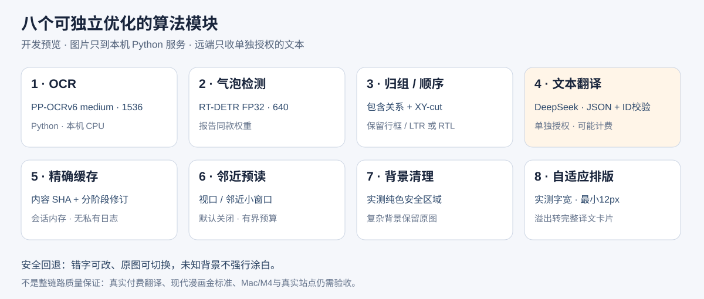

# Manga Live Translator

面向在线阅读的漫画翻译工具，追求低延迟和自然、理解上下文的 LLM 译文。

简体中文 | [English](README.en.md)

## 当前状态

这是 **dev 开发预览版**，尚未发布。当前方案为 Chrome 扩展 + 本机 Python 常驻服务：PaddleOCR 识别整页，RT-DETR 检测气泡，扩展归组、排序、请求可选文本翻译并显示可撤销译文。不会把漫画图片发送给翻译提供方；DeepSeek / OpenAI 文本翻译必须单独配置并授权，可能计费。

先按 [Python 服务安装指南](services/local-ocr/README.md) 启动服务，再构建扩展并在设置中填写 `http://127.0.0.1:8787` 与本机令牌。首次主动下载四份模型共 **307,816,501 字节，约 293.6 MiB**，SHA-256 校验后缓存；状态轮询不触发模型下载。详见[开发预览指南](docs/development/preview.md)。

## 八个算法模块

下表是当前代码选择，不是模型质量排名；每项均可独立替换并更新修订及回归测试。

| 模块 | 当前算法 / 方案 | 实现入口与优化边界 |
| --- | --- | --- |
| 1. 文字检测与 OCR | Python RapidOCR 3.10.0 + ONNX Runtime 1.23.2，PP-OCRv6 medium 检测/识别 + 旧版180°分类器；短边1536、长边上限4096、单线程CPU | [本地引擎](services/local-ocr/manga_local_ocr/engine.py)、[固定配置和资产哈希](services/local-ocr/manga_local_ocr/config.py)。整页运行，保留行框、置信度和原始坐标；不再使用浏览器 WASM OCR。 |
| 2. 气泡检测 | 与本轮报告相同的 FP32 RT-DETR `detector.onnx`，RGB/PIL 640×640、类别0、阈值0.5 | 同一本地引擎，权重168,481,531字节；不是旧11.1MB int8模型。仅气泡框，无真实像素轮廓/分镜分割。可显式跳过，OCR仍整页执行。 |
| 3. 归组与阅读顺序 | 行中心 + ≥85%包含率分配气泡，最小嵌套框优先；递归 XY-cut + 重叠行排序，页面LTR/RTL可选 | [grouping.js](packages/core/grouping.js)。稳定组ID保留成员行与原坐标；歧义和框外字幕独立保留。几何分区不是检测到的分镜，RTL不反转英文句子。 |
| 4. 上下文与翻译 | 默认 DeepSeek V4.1 Flash（API型号 `deepseek-flash`）JSON Object，按整页有序文本组请求；本地严格验证所有ID；可选上下文/术语表 | [DeepSeek适配器](extension/adapters/deepseek.js)。按用户选择默认 `deepseek-flash`，界面可见实际API型号；保留OpenAI适配器。无自动付费重试、无图片/VLM调用；未实现角色记忆/自动跨页摘要。 |
| 5. 精确缓存 | SHA-256内容身份、分阶段键、LRU/TTL/字节上限、single-flight、清除代次隔离 | [流水线](packages/core/pipeline.js)、[键](packages/core/keys.js)。原始OCR不因气泡/顺序/上下文改变而重跑；归组几何/修订、原文编辑、提供方/账户/模型/术语/上下文参与译文身份。默认会话内存，不持久保存漫画。 |
| 6. 小窗口预读 | 当前已加载图片，视口优先、邻近其次，滚动后重排，远处不启动；本地与远端独立预算 | [调度器](extension/content/scheduler.js)。默认关闭，最多80图、2个在途任务；Python推理串行。远端提前翻译单独授权，不跨章抓取或预测翻页；并非研究模拟器的完整自适应策略。 |
| 7. 背景清理 | 实际不透明像素检查 + 保守纯色矩形覆盖 | [typesetting.js](extension/content/typesetting.js)。仅当气泡内文字框外颜色一致且源区不密集时，用实测颜色覆盖文字联合框；不是分割mask/Telea/LaMa。复杂背景、未知证据直接保留原图，使用独立译文卡片。 |
| 8. 自适应排版 | 浏览器 `measureText`、递减字号搜索、折行与中英标点约束、最小12px | 同上及[阅读器](extension/content/reader.js)。字号过小、溢出或图片裁切则改用完整译文卡片，不静默截字；支持原图切换与文本修正。 |

图片来源授权、4MiB/1600万像素预算、环回Bearer/Host/Origin校验和明确错误处理是各模块共用的安全边界。模型为本机下载，扩展不接受网页指定服务地址或任意转发请求。Magpie 未接入：当前直接使用固定 DeepSeek / OpenAI 文本端点。

## 验证与已知限制

- 本机服务沿用已测的 medium1536 参数；新服务复核10/10图输出与旧基线完全一致，重新评分CER13.45%、WER39.66%。约23.22秒/图是此前云CPU原生服务结果，**不是这次全部八模块的端到端成绩，也不是M4性能承诺**。
- 本轮RT-DETR研究仅有3页、36个助手粗标主体框，未独立人工复核；归组、修复与排版研究包含合成/真值条件，不能转写为产品准确率。
- 新的实际模型检查、单元/工具测试和 Chromium/CI状态集中记录于[本次集成验收](docs/development/native-pipeline.md)。合成HTTP/LLM夹具只验证接线，不代表真实翻译质量。没有付费请求或私有漫画外发。
- 复杂背景保留原图是刻意的安全回退。文字框内的绘画仍可能与字形混淆，低置信度OCR、错误气泡归属和复杂阅读顺序仍需人工修正。

## 项目目标

- **高性能、低延迟：** 尽量缩短从打开漫画页面到阅读译文的等待时间。
- **自然的大语言模型翻译：** 利用大语言模型生成流畅、符合上下文的对白。
- **在线阅读：** 让浏览器中的漫画自动翻译更方便。

## 首版实施计划

[首版需求与实施计划](docs/plans/v0.1/README.md)涵盖拟议的 MVP、架构、缓存设计、研究来源、验收门槛和待评审决策。该计划仍是需求基线；预览指南区分已实现范围与尚未完成的验收项。

## 欢迎贡献

欢迎提交 Issue 和 Pull Request，分享想法、报告问题或改进项目！请先阅读 [Issue 指南](docs/ISSUES.md)，使用缺陷或功能建议表单。贡献者、维护者、dot 和其他机器人遵循同一格式。

## 开发语言

开发沟通、新增或修改的文档、代码注释、文档字符串及 Issue 默认使用中文；这取代了之前的仅英文约定。历史英文研究、计划及许可证来源记录按需查阅，不代表本次已将整个项目翻译成中文。标识符、API、命令及第三方原文保持不变；英文 README 已单独提供；其他历史文档在翻译前保留现有语言。

## 分支流程

开发在 dev 分支进行。针对最终修改运行适用测试，只有获得明确授权后，才将验证通过的工作合并到 main 用于发布。请按预览指南运行 `npm test`、`npm run test:tooling`、`npm run build` 和合成浏览器冒烟测试。dev 上的修改不会自动发布；合并或发布是需要明确授权的独立步骤。完整开发流程见 [AGENTS.md](AGENTS.md)。

## 开发知识

开发前请依次阅读本 README、[MEMORY.md](MEMORY.md) 和 [AGENTS.md](AGENTS.md)。MEMORY.md 是项目开发经验、陷阱、决策和测试经验的索引。

## 提交与推送检查

每个开发提交必须同时更新 PUBLISH.md 和 memory/ 下的一份实际经验记录。仓库中的提交、合并和推送钩子会检查此要求，但克隆仓库不会自动启用。安装方法、行为和测试见[检查钩子指南](docs/change-record-hooks.md)；检查已有钩子后，可在每个克隆中自行执行 `git config --local core.hooksPath .githooks` 启用。

## 更新历史

项目变更见 [PUBLISH.md](PUBLISH.md)。发布更新将按版本和日期记录，并按实际情况说明新增、改进、修复、兼容性变化和升级注意事项。

## 许可证

项目采用 [MIT License](LICENSE)。在保留版权声明和许可声明的前提下，可使用、修改、分发本软件，也可用于商业用途。完整条款及免责声明请参阅 LICENSE；许可证原文保持不变。

## 方案对比实验

[中文漫画10图、五方案CPU实测](docs/evaluation/chinese-comics-2026-11-03/README.md)：区分检测、OCR错字漏字与耗时，供选择下一阶段方案；没有自动替换产品默认实现。

[英文与日文图文评测](docs/evaluation/english-japanese-2026-11-03/README.md)：独立语言样本、实际错漏字和耗时图，保留原始指标与范围限制。

[英文漫画Paddle七组型号对照](docs/evaluation/paddle-english-models-2026-11-03/README.md)：同图同标注比较英语专用v5与v6三个尺寸，先看图表选质量、速度和体积取舍。
