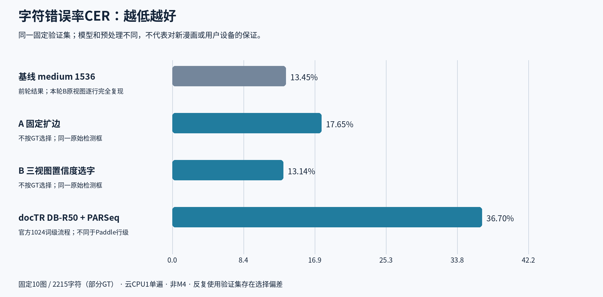
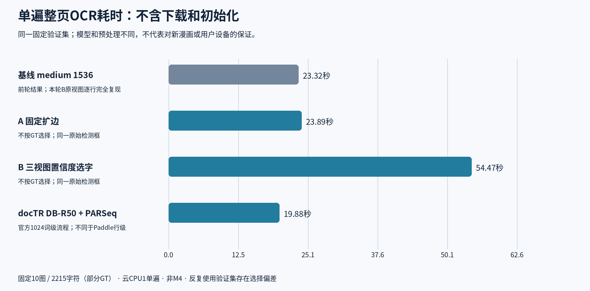

# 英文漫画：更高精度路线追加实测

**这一批没有找到值得直接替换的明显赢家。** 三组新增方案各测同10图，共30次完整单遍调用；另引用前轮medium1536作为基线。

- **暂保留medium1536作为质量参考。** 三视图重识别只有13.45%→13.14%的小幅改善：2215字符中少7次编辑错误，却从23.32秒增至54.47秒/页。
- **固定扩边和docTR都变差。** 不能把更复杂流程、更多推理或官方通用榜单当作漫画精度保证。
- **下一候选是LightOnOCR-3-1B。** 官方Apache-2.0且支持文本块坐标，部署许可比部分漫画专用权重更清晰；本轮没有下载或测试，不保证它更准。

## 应该怎么选

| 需求 | 目前证据支持的选择 |
|---|---|
| 精度、开销相对平衡 | 维持medium1536作为候选，不因本轮修改产品默认 |
| 愿付2倍多开销试小幅提升 | 三视图B可继续验证，但先用新的独立漫画集确认，不能把0.32个百分点当稳定收益 |
| 想找实质更高精度 | 独立评测LightOnOCR-3-1B等不同结构；未测前不承诺胜出 |
| 直接采用漫画专用模型 | Magi有非商业条款，COMICS Text+原checkpoint许可未明；不直接作为MIT商业产品依赖 |

**范围：** 十张历史英文漫画、部分区域GT、云CPU单遍，非现代译制漫画的代表性随机集，非Mac或浏览器实测，亦非翻译质量。该验证集已反复使用，选择偏差不能忽略。CER不是“1−准确率”的产品承诺。

[完整逐图结果](RESULTS.md) · [方法、失败与资源口径](METHOD.md) · [官方模型/论文/许可证研究](RESEARCH.md) · [公开复现脚本](../../../scripts/evaluation/english-accuracy-followup/)
