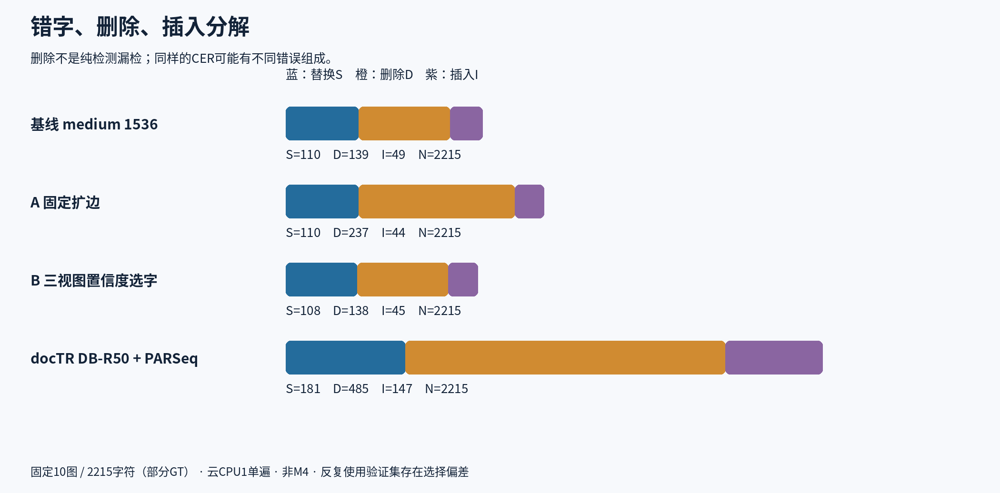

# 完整结果与错误分解

| 方案 | CER | WER | S/D/I | 完全正确目标/67 | 单遍秒/图 | 采样RSS GiB |
|---|---:|---:|---|---:|---:|---:|
| 基线 medium 1536 | 13.4537% | 39.6552% | 110/139/49 | 9 | 23.322 | 1.487 |
| A 固定扩边 | 17.6524% | 39.4636% | 110/237/44 | 13 | 23.887 | 1.527 |
| B 三视图置信度选字 | 13.1377% | 39.4636% | 108/138/45 | 10 | 54.470 | 1.521 |
| docTR DB-R50 + PARSeq | 36.7043% | 74.5211% | 181/485/147 | 5 | 19.881 | 1.420 |

总字符分母均2215。A/B无完全空目标；docTR有6个标注目标无预测词框归属。段落GT、Paddle行框、docTR词框粒度不同，不把这个代理叫精确检测召回率。CER中的删除D也不等于纯检测漏检。

## 逐图字符编辑数

| 图 | 基线 | A扩边 | B三视图 | docTR | 字符数N |
|---|---:|---:|---:|---:|---:|
| EN01 | 13 | 16 | 16 | 56 | 328 |
| EN02 | 26 | 23 | 26 | 364 | 417 |
| EN03 | 31 | 36 | 32 | 57 | 161 |
| EN04 | 3 | 4 | 3 | 24 | 24 |
| EN05 | 22 | 24 | 23 | 24 | 120 |
| EN06 | 47 | 48 | 47 | 72 | 243 |
| EN07 | 35 | 55 | 31 | 55 | 333 |
| EN08 | 25 | 21 | 22 | 48 | 100 |
| EN09 | 57 | 60 | 54 | 47 | 125 |
| EN10 | 39 | 104 | 37 | 66 | 364 |

逐图CER/WER、空目标代理及预测SHA见[data独立复核文件](data/)。没有发布完整GT或OCR转写。

## 为什么不把B的小改善包装成突破

B对全部696个预测行统一做三个视图，不通过GT挑结果。136行文本发生变化；按评分一致的NFKC去空白口径，46行变短、19行变长、71行同长度改字，总字符却从7981增至8033。这个诊断既不能证明整体偏短，也不能证明置信度与正确性有因果保证。

A扩边增加删除错误，说明“多留边缘”并不总有益；没有据这批GT进一步调出一个最好比例。docTR使用词级英文识别完整管线，接口和坐标已核验，但通用文档能力没有在本历史漫画集胜出。

## 运行与桥接核验

A/B原检测框逐图与旧medium1536相同，B原视图文字和分数也完全相同；没有另称本轮重跑了一个独立基线。docTR真实执行10/10，1647词，识别片段未结束EOS计数为0；EOS正常不等于内容正确。两种运行时不同，均CPU1，但不同输入缩放、粒度、框数和预处理不代表同算力等工作量。

前轮基线耗时引用原单遍23.3219651236秒。本轮A/B/doctr加载时间约0.946/1.066/4.290秒，另外计，不含网络下载、排队等待或LLM。所有完成组都保持全10图分母，初次接口/序列化失败详见[METHOD](METHOD.md)。
