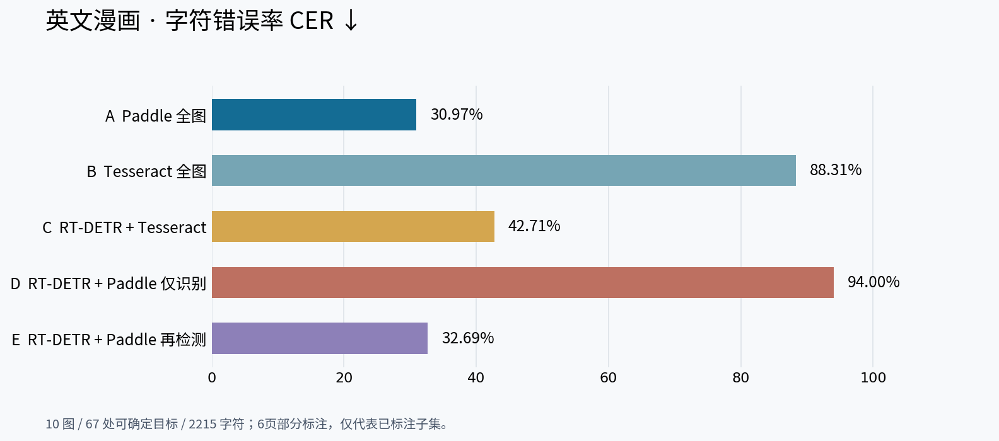
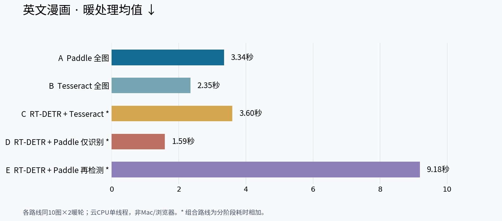
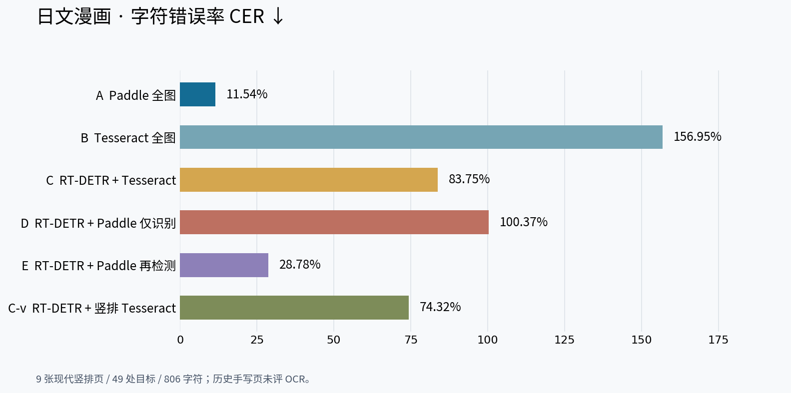
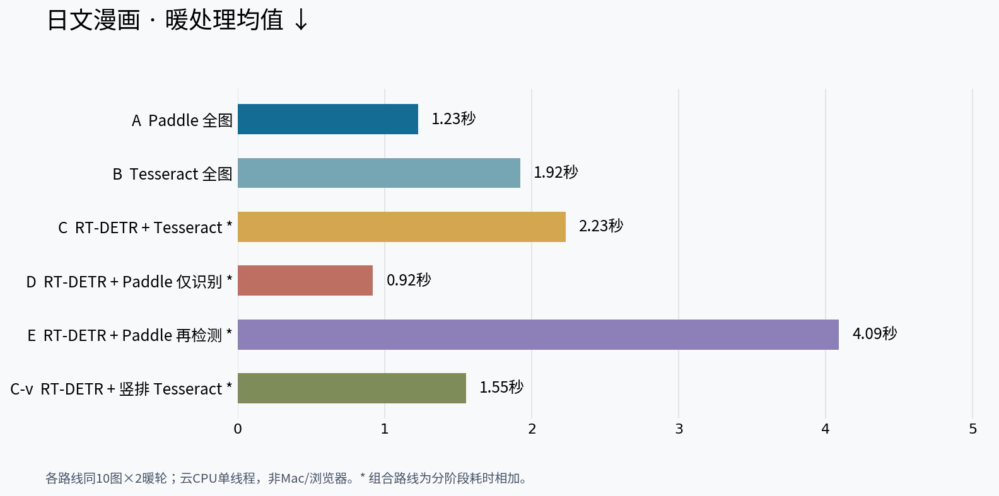
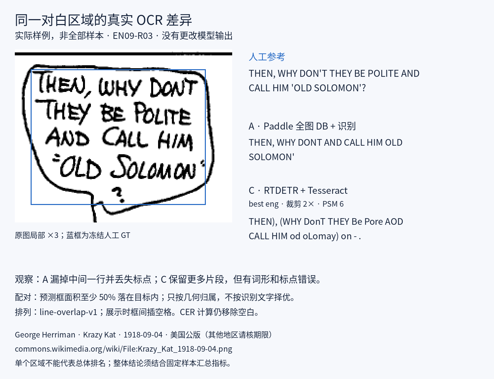

# 英文 / 日文漫画 OCR：图文对比

**先看结论：这两组小样本里，A「PP-OCRv5 全图检测+识别」质量最好；先裁出段落再重复检测，并没有更快。**

| 本轮样本 | A 字符错误率↓ | A 去标点错误率↓ | A 暖处理均值↓ |
|---|---:|---:|---:|
| 英文历史漫画：67处已标目标 | 30.97% | 26.83% | 3.345秒/图 |
| 日文现代竖排：49处目标 | 11.54% | 7.79% | 1.226秒/图 |

这不是通用准确率排行榜：英文10图中6页只标了可核对子集；日文10图中1张古手写只测检测，OCR分数来自另9页、同一现代作品。云CPU单线程，**不是Mac M4、浏览器或翻译质量**。耗时对所有10图计算，OCR评估范围如上。

## 英文：手写历史漫画仍然难

A 的错漏字仍明显，不能把30.97% CER包装成“已经好用了”。E「段落里再DB」约9.185秒，质量没有超过A；D把多行段落直接送行识别器，接口粒度不匹配，漏字很多。EN05触发产品32区域预算：C按既定规则回退全图，D/E为空，不掩盖这个差别。

## 日文：专门竖排对照也实际跑了

A 在本组现代竖排上CER11.54%；C-v用了jpn_vert + PSM5，不是拿英文/中文语言包测试日文。D对多列段落直接识别几乎全漏，不能据此说PP-OCRv5本身不支持日文。**本组没有现代横排对白，不能外推到横排。**

图中的CER包含替换、删除、插入；插入很多时可以超过100%，并不是负的“准确率”。星号耗时是独立阶段实测相加，不是一体化管线墙钟。

## 看一处真实错误，而不是只看数字

同一冻结参考、同一实际输入：A漏中间行，C仍有词形和标点错误。这里只是EN09一处样例，不能代替总体统计。图中文字为公版素材；[来源与配对证据](assets/attribution.md)。水平样例按v1展示，与本轮v2的水平顺序完全一致。

## 怎么选

- **优先进入浏览器适配验证：A。** 本次中文、英文、日文分别实测均提示它值得先做，但这里没有完成它的浏览器WASM/MV3/M4性能验证。
- **RT-DETR保留为可选区域提示，不必强制前置。** 对长页/气泡筛选可继续研究，但E的重复检测成本很明显；检测定位好不等于OCR就好。
- **暂不采用D。** 需要先解决段落到行的接口，不能仅删掉检测步骤追求表面速度。
- **额外manga-ocr尚未测成。** 444MB官方模型已下载，固定版本tokenizer请求被网络代理403拒绝；未重试绕过、没有编分数。它不是本次排行榜中的输家，也不是已验证浏览器轻量候选。

**没有改变扩展默认方案，没有合并main。最终方案由你选择。**

## 需要核对时再展开

- [逐图分数、错漏字、严格WER、检测粒度与耗时明细](RESULTS.md)
- [方法、版本、计时范围与限制](METHODS.md)
- [人工标注范围、排除项及冻结哈希](ANNOTATION.md)
- [来源、许可、权重与复现入口](REPRODUCE.md)
- 原始数值：[英文](english/metrics.json) / [日文](japanese/metrics.json)；简表：[英文](english/summary.json) / [日文](japanese/summary.json)
- [此前中文10图实测](../chinese-comics-2026-11-03/README.md)：数据难度、分布和覆盖不同，不把跨语言差值解释为语言本身的因果效应。
