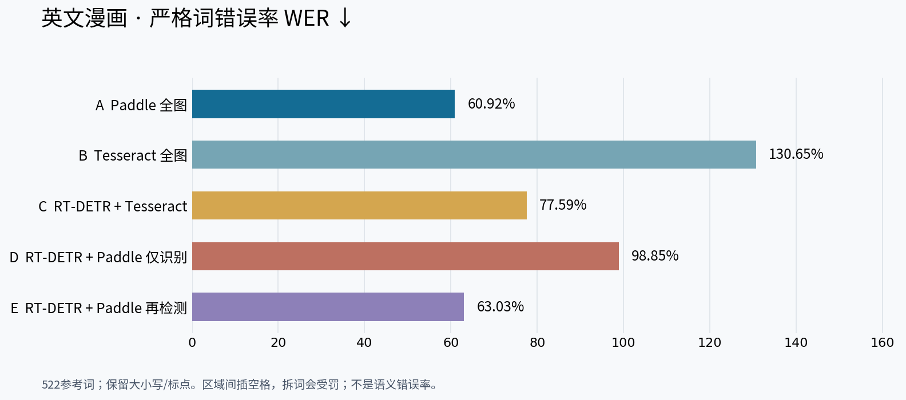
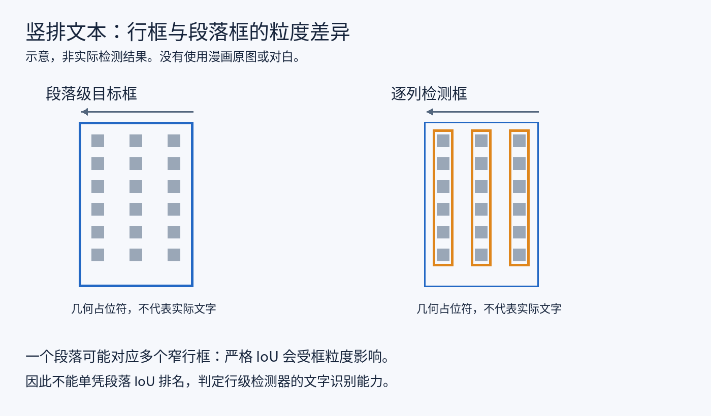
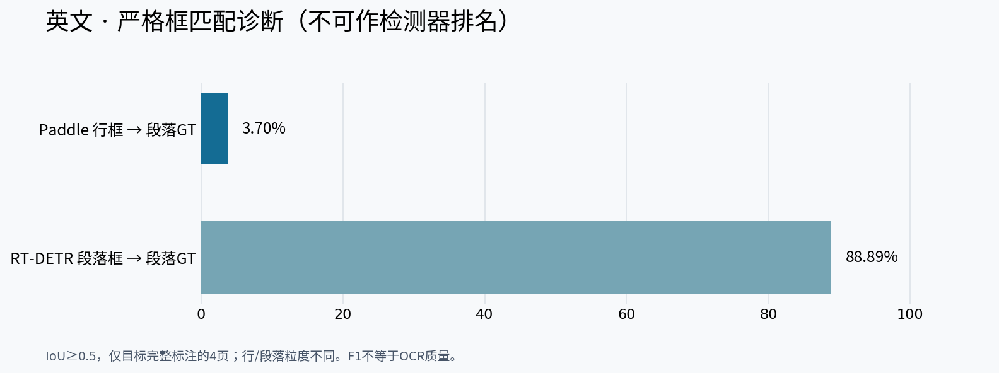
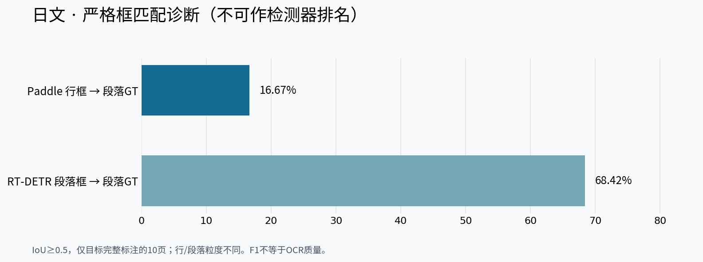
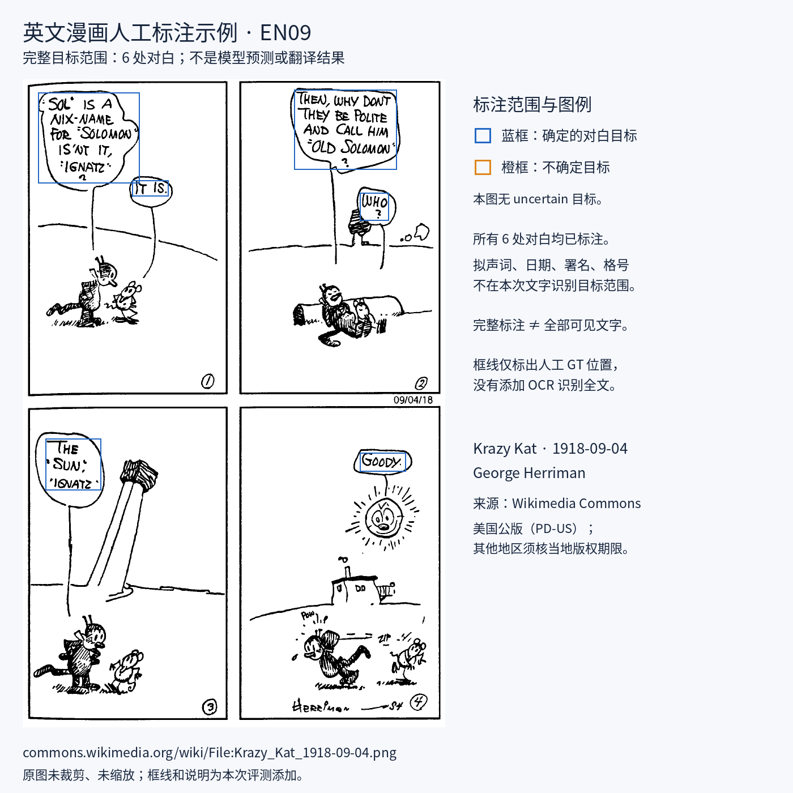

# 完整结果与逐图明细

所有数字来自本次冻结输入的真实运行。未采用外部论文的准确率或模型confidence冒充实测。

## 英文汇总

| 方案 | CER↓ | 去标点CER↓ | WER↓ | S替换 | D漏字 | I插入 | N参考 | 完全一致目标 | 暖秒/图↓ |
|---|---:|---:|---:|---:|---:|---:|---:|---:|---:|
| A Paddle 全图 DB+识别 | 30.97% | 26.83% | 60.92% | 185 | 453 | 48 | 2215 | 2/67 | 3.345 |
| B Tesseract 全图 | 88.31% | 82.45% | 130.65% | 449 | 1033 | 474 | 2215 | 0/67 | 2.351 |
| C RT-DETR + Tesseract | 42.71% | 37.86% | 77.59% | 566 | 280 | 100 | 2215 | 2/67 | 3.596* |
| D RT-DETR + Paddle 仅识别 | 94.00% | 93.63% | 98.85% | 71 | 2004 | 7 | 2215 | 0/67 | 1.588* |
| E RT-DETR + Paddle 再检测 | 32.69% | 27.78% | 63.03% | 218 | 493 | 13 | 2215 | 1/67 | 9.185* |

完全一致目标包含标点与大小写，不能称为语义正确率。* 为分阶段时间相加。暖均值是10图各两次的平均，不含下载与初始化；“首次处理该图”也不是每张都冷启动。

### 逐图CER / 暖秒数

| 图 | CER分母字符 | A | B | C | D | E |
|---|---:|---:|---:|---:|---:|---:|
| EN01 | 328 | 6.40% / 5.199s | 77.74% / 3.641s | 13.11% / 6.866s | 95.43% / 2.542s | 14.63% / 17.496s |
| EN02 | 417 | 16.07% / 6.061s | 97.60% / 4.585s | 32.37% / 7.159s | 99.76% / 3.180s | 11.75% / 19.724s |
| EN03 | 161 | 31.68% / 2.064s | 98.76% / 0.783s | 63.35% / 1.435s | 77.64% / 1.142s | 42.24% / 4.838s |
| EN04 | 24 | 16.67% / 1.525s | 445.83% / 0.758s | 83.33% / 1.066s | 87.50% / 0.973s | 41.67% / 2.260s |
| EN05 | 120 | 37.50% / 4.973s | 70.83% / 4.870s | 47.50% / 10.392s | 100.00% / 0.830s | 100.00% / 0.829s |
| EN06 | 243 | 42.80% / 3.954s | 68.31% / 2.228s | 58.02% / 2.163s | 91.77% / 1.668s | 42.39% / 15.921s |
| EN07 | 333 | 38.74% / 2.816s | 51.95% / 1.762s | 36.04% / 1.787s | 97.60% / 1.335s | 33.03% / 11.738s |
| EN08 | 100 | 41.00% / 1.565s | 304.00% / 2.151s | 59.00% / 1.508s | 98.00% / 0.908s | 45.00% / 4.031s |
| EN09 | 125 | 55.20% / 0.970s | 72.80% / 0.284s | 64.00% / 0.982s | 99.20% / 0.931s | 52.80% / 3.263s |
| EN10 | 364 | 42.58% / 4.319s | 57.42% / 2.448s | 51.92% / 2.602s | 87.09% / 2.367s | 28.85% / 11.746s |

每格为CER / 暖秒数。日文JA01为未评OCR而不是0错；仍完成推理并记录耗时。英文部分标注页不把未标范围当负例。

### 框排序敏感性（不改GT或模型输出）

| 方案 | 旧v1 CER | 本轮v2 CER |
|---|---:|---:|
| A | 30.97% | 30.97% |
| B | 88.31% | 88.31% |
| C | 42.71% | 42.71% |
| D | 94.00% | 94.00% |
| E | 32.69% | 32.69% |

v2用对称的固定几何列聚类处理竖排字框x抖动，水平与v1一致。这个差异来自评测阅读顺序，不是模型准确率升级；合成测试预先验证规则，没有按GT文本或候选分数择优。默认旧评分器仍兼容历史中文结果。

## 日文汇总

| 方案 | CER↓ | 去标点CER↓ | WER↓ | S替换 | D漏字 | I插入 | N参考 | 完全一致目标 | 暖秒/图↓ |
|---|---:|---:|---:|---:|---:|---:|---:|---:|---:|
| A Paddle 全图 DB+识别 | 11.54% | 7.79% | 未评 | 10 | 72 | 11 | 806 | 25/49 | 1.226 |
| B Tesseract 全图 | 156.95% | 160.44% | 未评 | 180 | 292 | 793 | 806 | 0/49 | 1.921 |
| C RT-DETR + Tesseract | 83.75% | 75.39% | 未评 | 242 | 156 | 277 | 806 | 3/49 | 2.229* |
| D RT-DETR + Paddle 仅识别 | 100.37% | 100.31% | 未评 | 2 | 804 | 3 | 806 | 0/49 | 0.918* |
| E RT-DETR + Paddle 再检测 | 28.78% | 12.31% | 未评 | 32 | 196 | 4 | 806 | 9/49 | 4.088* |
| C-v RT-DETR + 竖排 Tesseract | 74.32% | 60.28% | 未评 | 139 | 141 | 319 | 806 | 8/49 | 1.551* |

完全一致目标包含标点与大小写，不能称为语义正确率。* 为分阶段时间相加。暖均值是10图各两次的平均，不含下载与初始化；“首次处理该图”也不是每张都冷启动。

### 逐图CER / 暖秒数

| 图 | CER分母字符 | A | B | C | D | E | C-v |
|---|---:|---:|---:|---:|---:|---:|---:|
| JA01 | 0 | 未评 / 1.536s | 未评 / 2.379s | 未评 / 4.105s | 未评 / 0.981s | 未评 / 5.995s | 未评 / 2.184s |
| JA02 | 65 | 13.85% / 1.128s | 192.31% / 1.871s | 240.00% / 4.891s | 100.00% / 0.889s | 16.92% / 3.729s | 298.46% / 3.402s |
| JA03 | 149 | 22.15% / 1.291s | 133.56% / 1.952s | 77.18% / 2.079s | 100.00% / 1.012s | 46.31% / 5.382s | 77.18% / 1.472s |
| JA04 | 52 | 0.00% / 0.981s | 176.92% / 1.103s | 75.00% / 1.069s | 100.00% / 0.846s | 61.54% / 3.163s | 75.00% / 1.008s |
| JA05 | 91 | 1.10% / 1.317s | 178.02% / 2.442s | 51.65% / 1.563s | 100.00% / 0.892s | 5.49% / 2.971s | 12.09% / 1.224s |
| JA06 | 102 | 16.67% / 1.465s | 142.16% / 2.024s | 79.41% / 2.377s | 100.98% / 1.125s | 32.35% / 6.739s | 55.88% / 1.423s |
| JA07 | 4 | 200.00% / 0.715s | 2925.00% / 1.610s | 125.00% / 0.800s | 125.00% / 0.737s | 50.00% / 1.412s | 575.00% / 0.876s |
| JA08 | 191 | 3.66% / 1.548s | 109.95% / 2.815s | 58.12% / 2.248s | 100.00% / 0.978s | 23.56% / 5.102s | 40.84% / 1.638s |
| JA09 | 24 | 25.00% / 0.989s | 287.50% / 1.022s | 100.00% / 1.011s | 100.00% / 0.795s | 33.33% / 1.632s | 75.00% / 0.877s |
| JA10 | 128 | 9.38% / 1.286s | 114.06% / 1.992s | 75.78% / 2.146s | 100.78% / 0.921s | 21.09% / 4.751s | 50.00% / 1.408s |

每格为CER / 暖秒数。日文JA01为未评OCR而不是0错；仍完成推理并记录耗时。英文部分标注页不把未标范围当负例。

### 框排序敏感性（不改GT或模型输出）

| 方案 | 旧v1 CER | 本轮v2 CER |
|---|---:|---:|
| A | 11.54% | 11.54% |
| B | 167.49% | 156.95% |
| C | 98.39% | 83.75% |
| D | 100.37% | 100.37% |
| E | 33.62% | 28.78% |
| C-v | 91.32% | 74.32% |

v2用对称的固定几何列聚类处理竖排字框x抖动，水平与v1一致。这个差异来自评测阅读顺序，不是模型准确率升级；合成测试预先验证规则，没有按GT文本或候选分数择优。默认旧评分器仍兼容历史中文结果。

## 英文严格WER

参考522词；保留大小写、标点、历史拼写。框之间加空格，因此拆词或标点独立成框会增加WER；不能和去标点、大小写无关的外部WER直接对比。日文不假分词，没有WER。

## 检测：先理解粒度，再看数字

这些图**不能作为检测器质量排名**：Paddle输出行框，RT-DETR输出段落相关框，同一段落GT下的IoU不是相同任务。Paddle严格框F1低，却OCR最好，这正说明分割粒度会影响这个诊断。Tesseract全图仅有OCR词框，不编造独立检测器成绩。

| 语言/检测输出 | 完整标注页数 | TP | FP | FN | Precision | Recall | F1 |
|---|---:|---:|---:|---:|---:|---:|---:|
| 英文 / Paddle行框 | 4 | 2 | 88 | 16 | 2.22% | 11.11% | 3.70% |
| 英文 / RT-DETR段落框 | 4 | 16 | 2 | 2 | 88.89% | 88.89% | 88.89% |
| 日文 / Paddle行框 | 10 | 18 | 143 | 37 | 11.18% | 32.73% | 16.67% |
| 日文 / RT-DETR段落框 | 10 | 39 | 20 | 16 | 66.10% | 70.91% | 68.42% |

阈值IoU≥0.5；完整页仅指既定对白/旁白范围。英文只在EN03/04/08/09四页统计P/F1，不把其余partial页当完整负例。日文检测包含JA01的6个未转写定位框。C/D/E/C-v共享相同检测结果，不是四次独立检测器实验。0.3阈值及逐图结果见各语言metrics.json。

## 人工目标示例

仅展示目标定义，不是模型检测结果。原图、标注协议、输入哈希与许可分别见来源记录；现代日文原图/完整转写不公开。
