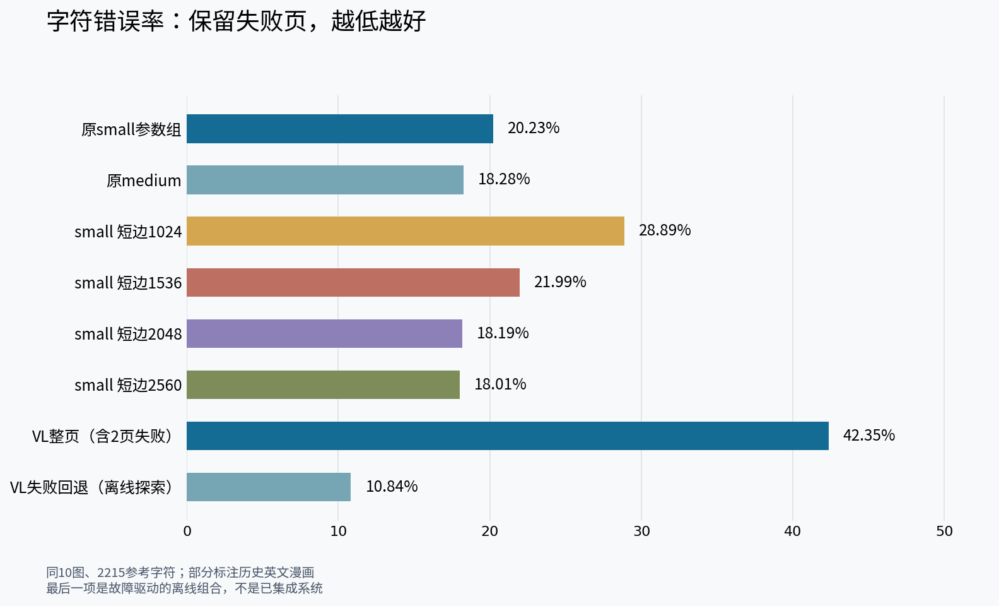
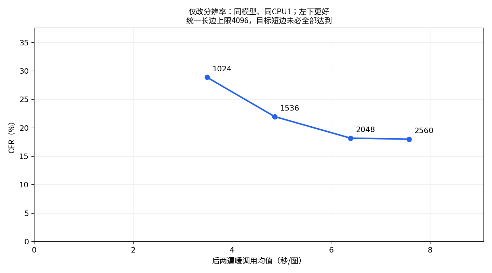
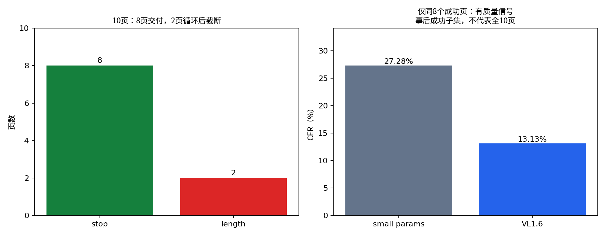
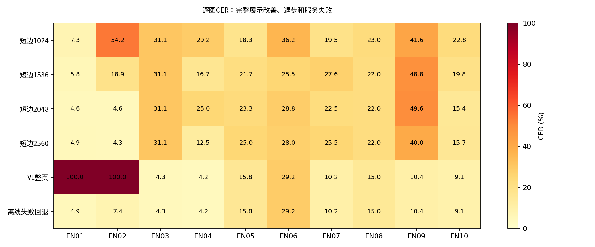

# 精度优先：分辨率有用，VL有潜力但还不稳

**本轮建议：传统OCR优先验证短边2048、长边上限4096；质量增强继续研究本地VL＋失败回退，不直接把VL整页设为默认。**

同10张历史英文漫画、同冻结标注：传统OCR四档各30次全部完成；PaddleOCR-VL-1.6整页10次完成，8页成功、2页循环截断。不是现代英译漫画代表性测试，也没有测试中文翻译质量。

## 先看三点

- **放大到2048有效：** CER从1024档的 **28.89%降至18.19%**，字符删除476→242；暖调用 **3.49→6.39秒/图**。同模型、同CPU1，仅空间预处理不同。
- **继续放大收益很小：** 2560档CER **18.01%**，只比2048少4次编辑；删除数仍242，WER反而变差，耗时 **7.57秒**，进程峰值RSS **2.18GB**（2048为1.47GB）。不是越大越好。
- **VL不能裸跑就交付：** 全10图CER **42.35%**，主要受两页服务失败影响；正常完成的同8页CER **13.13%**，传统固定参数组为 **27.28%**。有提升信号，但这不是全10页结果，也不能保证新样本收益。

## 分辨率的实际折中

| 目标短边 | CER↓ | 去标点CER↓ | WER↓ | 暖调用秒/图↓ | 进程峰值RSS |
|---|---:|---:|---:|---:|---:|
| 1024 | 28.89% | 24.87% | 55.17% | 3.49 | 1.00GB |
| 1536 | 21.99% | 17.10% | 48.66% | 4.86 | 1.10GB |
| 2048 | 18.19% | 13.19% | 43.49% | 6.39 | 1.47GB |
| 2560 | 18.01% | 12.74% | 44.64% | 7.57 | 2.18GB |

统一长边上限4096，超长条无法同时达到目标短边。多档可能变成相同实际尺寸；检测和识别裁图都受空间预处理影响。每图3遍输出完全一致，时延用后两遍平均。RSS为进程累计峰值，不是每张图独立内存。

## 更大模型究竟值不值？

本地 **PaddleOCR-VL-1.6 GGUF，约1.82GB权重**，云CPU4，平均单次页面请求 **126.29秒**、峰值RSS **2.92GB**。该请求时间不含事先图片转换，不是浏览器或M4结果，也不能与CPU1暖调用直接算加速比。

- EN01：5组完整坐标后连续输出4023个“0”。
- EN02：同一“文字＋坐标”串重复247次。
- 两页均耗尽4096输出预算，按冻结规则整页失败并计入全部分母；其余8页正常结束。
- 相似退化在官方仓库有讨论，但**本次根因未确认**。增加输出上限可能只是生成更多重复内容；不能把服务失败等同于模型纯识字能力。[排查证据](VL-DIAGNOSTIC.md)

**探索性离线故障回退：CER 10.84%，WER 31.80%。** 仅将VL明确失败的两页整页换为此前固定small参数组的真实输出，其余8页保留全部VL文字与坐标。没有按GT挑字/拼接，也没有改主VL分数。

这项组合是观察故障后提出的探索，**不是已经实现或实测延迟的混合系统**，不能把它当独立新数据验证。需要进一步解决取消/重复检测/回退与本机部署；产品默认模型未修改。[组合规则](OFFLINE-FALLBACK.md)

## 不只看平均值

2048→2560并非所有图片一起变好。部分标注、历史字体、大小写和标点都会影响结果；CER是字符编辑率，不是翻译准确率，也不等于“100%-CER”的识字正确率。

**下一步优先级：** 先验证2048传统OCR的真实浏览器成本与现代英文样本；质量增强路线继续对本地VL的裁图识别、重复防护和明确失败回退做独立实验。Qwen3-VL-4B Q8约5.12GB可作第二候选，但本轮没有运行，不能宣称更准确。不要仅凭官方文档榜单更换模型。

- [完整数字、尺寸与逐图数据](RESULTS.md)
- [冻结协议、指标与公平比较边界](METHODS.md)
- [候选、论文/官方代码、许可与Mac/浏览器部署](CANDIDATES.md)
- [复现脚本与公开证据](../../../scripts/evaluation/paddle-accuracy-resolution/README.md)
- [上一轮七型号实测](../paddle-english-models-2026-11-03/README.md)

本轮仅在云电脑本机推理，未向第三方推理服务发送漫画、未调用付费API、未操作用户电脑，未合并main或发布。
