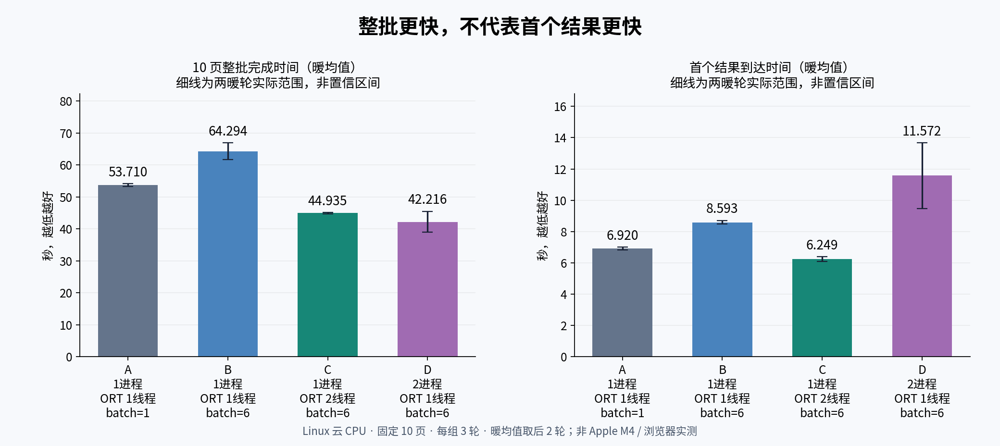
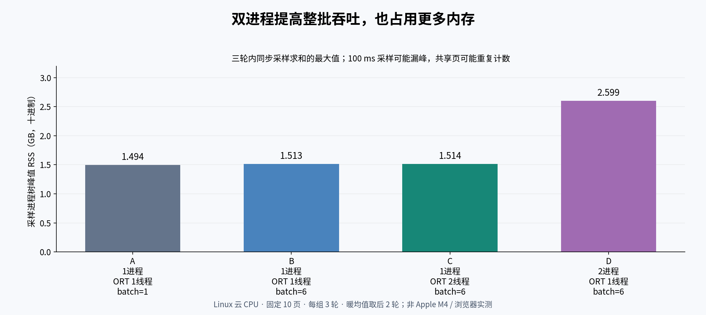
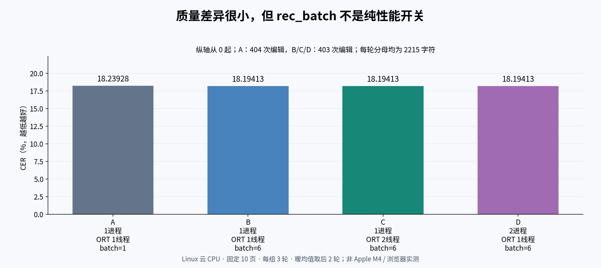

# Paddle 四组并发与识别 batch 实测

## 先看结论

在这组 Linux 云 CPU、固定 10 页英文漫画测试里，C 的首个结果最快，D 的整批吞吐最高。两者的 OCR 输出一致，但 D 的优势不是免费获得的：它需要更大的进程树 RSS，首个结果也更晚到达。这里不是 Apple M4、GPU 或浏览器端性能结论，也不是产品默认设置变更。

A 把 rec_batch 从 6 改成 1 后，比 B 更快，但文本/框输出也略有变化。**rec_batch 不能视为保证输出不变的纯性能开关。** A 的 CER 比 B/C/D 多 1 次净编辑，WER 却更低，不能概括为所有质量指标都变差，或完全没有质量变化。

## 固定输入与统计口径

- 同一套 v6 small 权重、字典、检测参数和原 10 张图；短边目标 2048、长边上限 4096，保持纵横比。受长边上限影响，不是每张图短边都达到 2048。
- A/B 只改变识别 rec_batch；B/C 只改变单个进程的 ORT intra-op 线程数；B/D 只改变工作进程数。全部 ORT inter-op 为 1，OpenCV/BLAS 为 1 线程。
- 每组跑完整 10 页，共 3 轮。第 0 轮独列，暖均值只取第 1、2 轮。总计 120 次页面处理，没有按成绩挑选某一轮。
- 所有模型工作进程就绪后才提交页面。整批时间是提交至全部结果返回，首结果时间是提交至第一个结果到达协调进程。包括队列与 IPC，不包括模型初始化、等实验锁和结果落盘。
- 主吞吐为 **20 / 两暖轮整批时间之和**，不是两轮各自吞吐率的算术均值。图中范围线是两次观测的最小/最大值，不是置信区间。
- RSS 是每 100 ms 同时采样协调进程及工作进程，先求和再取三轮内最大值，不是各进程独立峰值相加。可能漏掉瞬时峰值，共享页也可能重复计数；不能当作独占物理内存或精确最低内存需求。
- 实验使用共享锁串行协调；未证明宿主机无其他负载，也没有足够轮次作统计显著性结论。

## 精确汇总

显示值保留六位小数，完整浮点数见 [原始聚合 summary](data/paddle-summary.json) 和 [图表数据](assets/paddle-chart-data.json)。表中 GB 使用十进制 10⁹ bytes。

| 组 | 工作进程 | ORT intra / inter | rec_batch | 初始化就绪 s | 首轮整批 s | 暖整批均值 s | 暖首结果均值 s | 暖总吞吐 页/s | 采样峰值 RSS GB |
|---|---:|---:|---:|---:|---:|---:|---:|---:|---:|
| A | 1 | 1 / 1 | 1 | 0.713898 | 62.108996 | 53.710199 | 6.920299 | 0.186184 | 1.494401 |
| B | 1 | 1 / 1 | 6 | 0.645668 | 74.529532 | 64.293840 | 8.592868 | 0.155536 | 1.512628 |
| C | 1 | 2 / 1 | 6 | 0.812620 | 52.372117 | 44.935085 | 6.249244 | 0.222543 | 1.513640 |
| D | 2 | 1 / 1 | 6 | 0.761541 | 41.702813 | 42.216213 | 11.572046 | 0.236876 | 2.598748 |

### 同一 GT 下的质量

每轮分母均为 2215 字符；CER = (替换 S + 删除 D + 插入 I) / N。沿用既有几何归属与 line-column-overlap-v2 排序，保留大小写和标点，不按文本相似度重新配对。它衡量定位、排序和识别的组合误差，并非只评估已正确裁出的字。三轮逐组分数和输出均稳定。

| 组 | CER % | WER % | 去标点 CER % | S | D | I | 总编辑 | 完全匹配目标数 |
|---|---:|---:|---:|---:|---:|---:|---:|---:|
| A | 18.239278 | 42.911877 | 13.239719 | 106 | 246 | 52 | 404 | 9 / 67 |
| B | 18.194131 | 43.486590 | 13.189569 | 109 | 242 | 52 | 403 | 9 / 67 |
| C | 18.194131 | 43.486590 | 13.189569 | 109 | 242 | 52 | 403 | 9 / 67 |
| D | 18.194131 | 43.486590 | 13.189569 | 109 | 242 | 52 | 403 | 9 / 67 |

B/C/D 的逐页框、文本及识别置信度相同；A 与 B 有 6 页的框或文本不同（若也比较置信度则有 8 页不同）。独立复算 12 轮评分与正式产物一致。详见 [跨组输出校验](data/cross-group-output-check.json) 与 [运行身份校验](data/validation.json)。

## C 和 D 怎么选

- **更在意交互首结果或内存：优先试 C。** 暖首结果 6.249 秒，采样峰值 1.514 GB。
- **更在意全部页面完成：D 可作为备选。** 暖整批 42.216 秒，比 C 少 6.05%；总体吞吐提高 6.44%。代价是首结果 11.572 秒，延后 85.18%，采样峰值 RSS 增加 71.69%。
- D 两暖轮整批分别为 45.461 / 38.972 秒；波动不可忽略。这只是 10 页、两次暖轮的观察，不足以保证换机器或换漫画后仍是同一排序。
- A 的净编辑数只多 1，并不表示每个字符输出相同；也不宜把很小的 CER 差异作为决定性能配置的唯一依据。改 rec_batch 后应做实际内容回归，而不只看耗时。

## 复现图表

运行 `python charts.py`，默认只读本目录的聚合数据。可用 `--summary`、`--output`、`--font` 覆盖路径；需要 Python、matplotlib 与中文字体。脚本不启动 OCR，也不读取或发布原图、完整人工转写或 OCR 全文。
