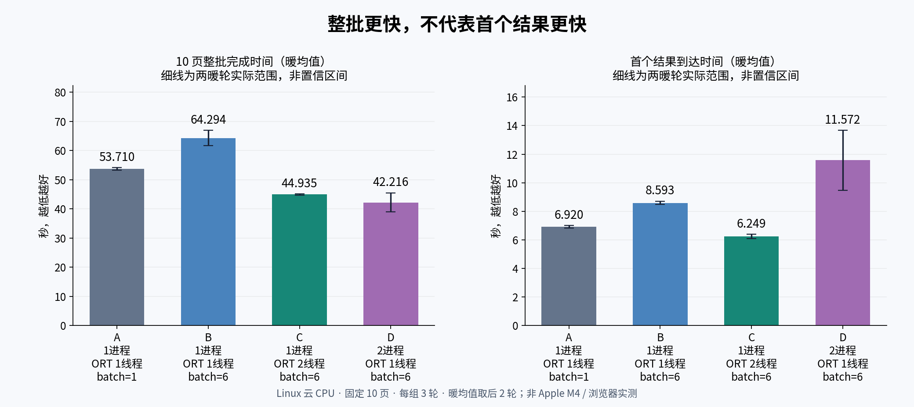

# 一次处理多张漫画：Paddle 批量实测与 Unlimited-OCR 2 核验

2026-11-03 · 英文漫画 → 中文翻译项目的 OCR 选型研究。仅评估 OCR 与运行方式，不衡量译文质量，不改变产品默认模型。

## 先看结论

- **一次选多张，不需要换成多页大模型。** 页面队列、文字行识别 batch、同一个模型上下文读取多页，是三种不同机制。
- **本轮 Paddle 更适合先采用 C 的调度思路：** 单 worker、ORT intra=2、文字识别 batch=6；10页暖批均44.94秒，首结果6.25秒。双 worker 整批略快，但第一张出来更晚、内存明显增加。这是云CPU实验结论，尚非产品默认配置或 M4 测速。
- **Unlimited-OCR 2 是值得研究的真实多页候选，但不能用“多页”推断漫画识别更准。** 官方 Transformers 多页全局视图与 MLX 的默认切块策略不同，必须固定模式后再比较。

**最新本地运行结果：** Unlimited-OCR 2社区量化版在Linux CPU成功加载，但两张合成页运行900.18秒仍无首token，按预先设置的超时停止；主进程采样峰值RSS4.61GB。没有完整输出，**没有得到该模型漫画CER**，不能据此判断模型精度或M4表现。未继续把同10图送入无法在既定界限完成的路线。

## 已完成的证据

| 内容 | 状态 | 阅读入口 |
|---|---|---|
| Paddle 固定10页、四种批处理/并发配置、每组3轮 | 120次全部完成；12份评分独立复算一致 | [图表、结果与限制](PADDLE-RESULTS.md) |
| Paddle 实际 batch 接口与源码核验 | 资料核验；没有把 list 输入当成联合多页推理 | [源码研究](PADDLE-RESEARCH.md) |
| Unlimited-OCR 2 的名称、许可、多页格式和部署 | 一手资料核验；漫画精度不依据文档榜单推断 | [候选说明](UNLIMITED-OCR2.md) |
| Unlimited-OCR 2 Linux CPU两页合成探针 | 已加载，900秒超时，0输出；非漫画质量结论 | [本地可行性记录](UNLIMITED-RUNTIME.md) |

## 共同基准与解释边界

本次继续使用历史英文10图的原图哈希及原始人工标注，未根据新模型输出修改标注。样本为 Little Nemo / Krazy Kat 等历史美国漫画，**不是现代英译日漫**。71个标注目标中67个明确文本区域计入OCR，4个不确定项排除；共2215个字符、522个英文词。部分页面只标注部分区域，因此不能声称全页总体检测精度。

评分使用既有 `score.py --wer --text-order line-column-overlap-v2`：只按几何重叠分配预测，不按文本相似度匹配；NFKC、删除Unicode空白，保留大小写和标点；附带去标点CER。字符删除数不等同于独立检测器漏检率。没有把完整预测或版权原图放入公开仓库。

本轮每组完整跑三批，首批与后两暖批分开；**不是**上一轮每图连续执行三次的同一计时结构。每组先初始化完全部worker，再从提交第一张至收到全部10张结果计时，包含排队与进程间通信。写结果文件与初始化不计入批耗时。首结果指最早收到的任意一张结果，不保证是输入第一张。

运行于Linux x86_64云CPU、AMD EPYC 9V74、约9.7GiB可见内存，无CUDA。共享锁避免本项目推理互扰，但不证明物理宿主机独占，cgroup配额不可见。C/D约束的是请求线程预算，不是操作系统全进程固定两线程。内存为同一采样时刻协调器与worker的RSS之和，100ms采样，可能重复计共享页和漏掉短峰。所有M4/浏览器性能仍需实测。

## 复现与完整证据

- [参数化复现入口](../../../scripts/evaluation/paddle-batch/README.md)
- [运行前冻结协议](../../../scripts/evaluation/paddle-batch/PROTOCOL.md)
- [四组汇总及三轮时间](data/paddle-summary.json)
- [120次输入身份与轮次验证](data/validation.json)
- [跨组输出差异检查](data/cross-group-output-check.json)
- [环境观察](data/host-observation.json)
- [上一轮分辨率与 PaddleOCR-VL 报告](../paddle-accuracy-resolution-2026-11-03/README.md)

## 对产品的建议，不是已实现承诺

先做“可见页优先 + 有界后台队列”，把首结果时间、整批吞吐和内存同时作为验收项。批处理参数会造成实际OCR文字差异，应纳入结果缓存的版本身份。多页联合模型还可能受相邻页、页序和提示影响，缓存不能只用单页图片哈希；或保持逐页OCR缓存，把跨页上下文放到用户明确启用的文字翻译阶段。

本轮不向第三方发送漫画图片，不调用付费模型；多页能力不改变隐私授权边界。研究结果尚未集成到浏览器扩展，也未合并 main 或发布版本。
