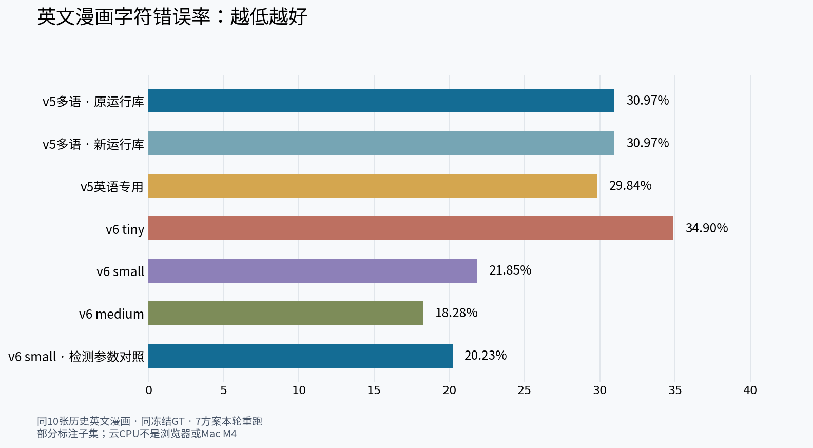
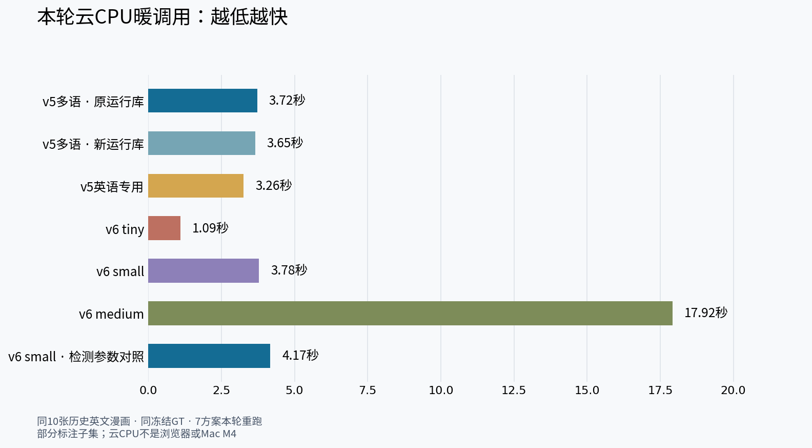
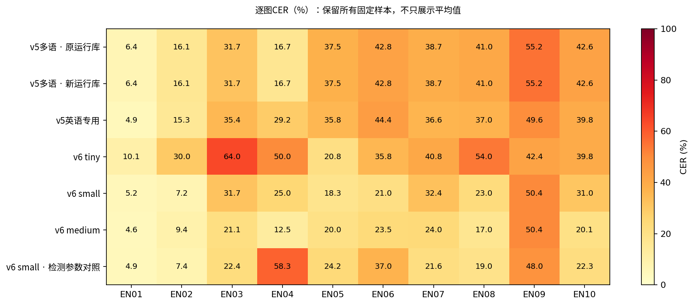
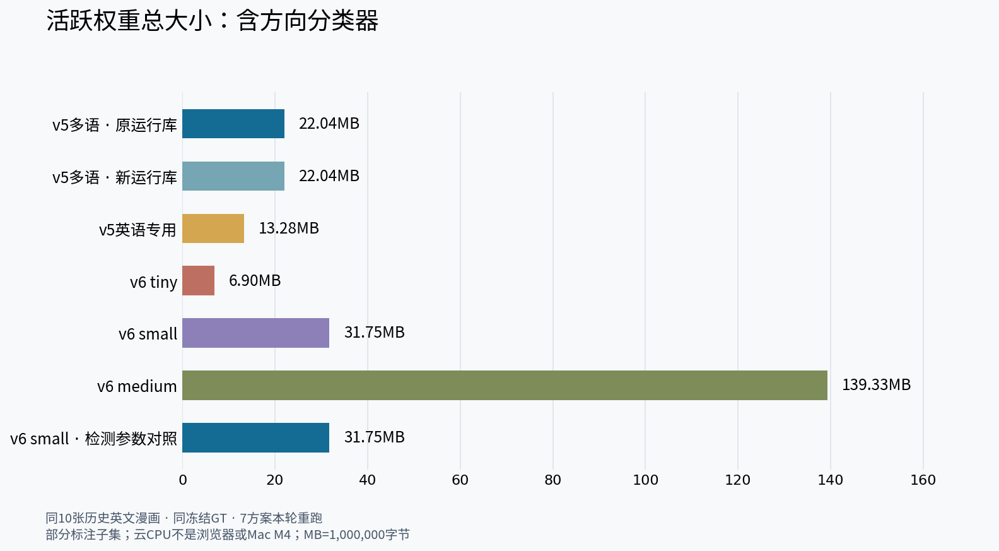

# PaddleOCR 英文漫画：七组实测怎么选

**优先把 v6 small 作为下一步浏览器集成候选；medium 留作质量优先对照，不直接设为默认。**

同一10张历史英文漫画、同一冻结标注、云CPU单线程，7组各30次，全部实际完成。只测OCR，不测中文翻译质量；这批不是现代英译漫画，结论不能泛化到所有漫画。

## 最重要的三个结论

- **兼顾速度：v6 small。** CER **21.85%**，平均 **3.78秒/图**，活跃权重 **31.75MB**。相对同库v5多语，CER下降9.12个百分点，耗时接近。
- **只追求本组最低CER：v6 medium。** CER **18.28%**，但 **17.92秒/图、139.33MB**；比small约慢4.74倍，CER仅再降3.57个百分点。
- **最轻最快并不最准确。** tiny **1.09秒/图、6.90MB**，但CER **34.90%**；英语专用v5 **29.84%**，对旧基线只有小幅改善。

## small 还需要选哪套参数？

同权重的“选定官方检测参数”对照把CER降到 **20.23%**，但WER略升（46.93% vs45.98%），与参考逐字一致块减少（7 vs10），EN04明显退步。**不是所有指标都更好**，不凭这10图自动替换默认参数。

## 下载体积与落地

以上是检测+识别+共用方向分类器的权重总量，MB按十进制，不含运行库。首次下载、内存峰值和浏览器WASM/WebGPU仍需单独验收；Python原生ORT能跑，不等于Chrome扩展已接好，更不是Mac M4实测。

当前没有更改产品默认模型、合并main或发布。建议下一步先验证small的浏览器速度/内存和现代英文样本，再由维护者选择最终方案；LLM只能辅助理解已识别文字，不能保证恢复漏掉的对白。

- [完整数值与逐图明细](RESULTS.md)
- [标注、计时、参数差异与局限](METHODS.md)
- [可复现脚本、模型SHA与许可](../../../scripts/evaluation/paddle-english-models/README.md)
- [原10图来源与图片哈希](../english-japanese-2026-11-03/english/sources.json)

后续：[放宽体积/速度后的分辨率与本地VL实测](../paddle-accuracy-resolution-2026-11-03/README.md)。本页保留原七型号实验结论，后续实验不覆盖其历史数值。
