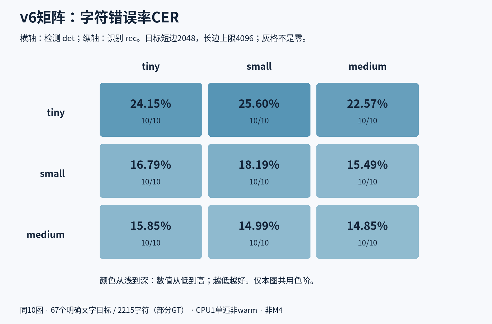
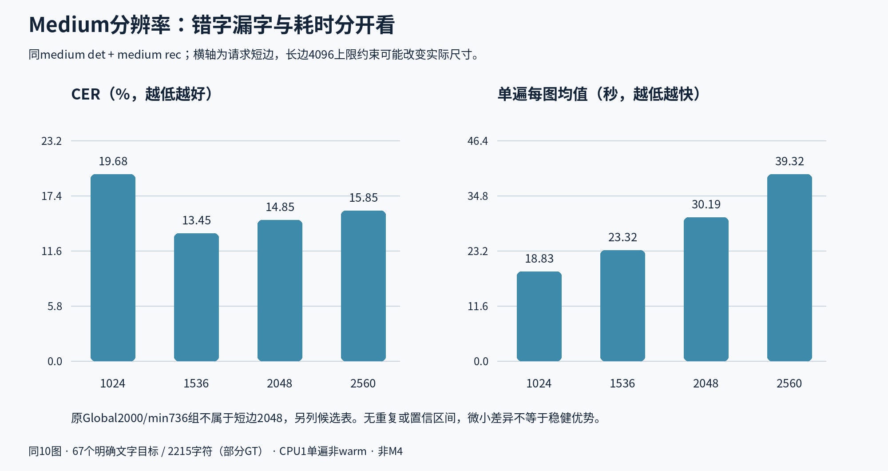

# Paddle型号、组件与分辨率：19组英文漫画实测

2026-11-03 · **19组 × 同10图 = 190次，全部完成**。每组单遍，云CPU1；原标注与输入哈希不变。主结果是OCR而非中文翻译质量，未改产品默认。

## 先看这四点

1. **没有官方v6 large。** v6只有tiny/small/medium，medium已是最大档；另外补了真实的v5 server，不能混称large。[型号与来源](MODELS.md)
2. **本轮最低CER是medium全套、目标1536：13.45%，23.32秒/页。** 到2048为14.85%，2560为15.85%，继续放大没有让字符更准；但2048的WER更低，两个指标不是同一个“最好”。
3. **不必整套都用大模型。** small检测＋medium识别在2048下CER14.99%、18.04秒/页；medium全套2048为14.85%、30.19秒，只差3次编辑。更在意速度时，tiny检测＋small识别为16.79%、5.21秒/页，可作为另一取舍。
4. **server和英文专用名字不保证优势。** v5 server全套共同2048为21.90%、48.00秒；同small检测器下，英文专用22.71%、Latin21.72%，均未超过small多语识别器的18.19%。这是本10图结果，不是所有英文漫画的普遍排名。

## 完整比较在哪里

- [全部19组表格、编号、CER/WER、时间、内存与实际权重体积](RESULTS.md)
- [测试方法、评分和失败口径](METHOD.md)
- [官方型号、许可与下载格式区别](MODELS.md)
- [候选总体精度与耗时图](assets/candidates.png)
- [v6时间矩阵](assets/v6-time.png) / [v6内存矩阵](assets/v6-rss.png)

## 哪些已测、哪些没有

| 范围 | 本轮完成 |
|---|---|
| v6检测器×识别器 | tiny/small/medium完整3×3，固定目标2048/cap4096 |
| medium分辨率 | 1024 / 1536 / 2048 / 2560 |
| medium参数隔离 | 保持原Global2000/min736缩放，更换预先冻结的检测参数 |
| v5 server | 长边960适配、共同2048、small检测＋server识别、server检测＋medium识别 |
| 英文与Latin分支 | 固定v6 small检测器、共同2048，各自正确字典单独比较 |

以上范围有重叠，例如medium2048同时属于3×3与分辨率系列，合计是19个唯一配置，**不是把每行数量相加**。其中small2048是新runner的桥接基线，10张框与文字全部复现先前同配置结果。此前三档默认型号的三轮测试见[早期报告](../paddle-english-models-2026-11-03/README.md)，没有拿旧结果冒充本轮新跑。

没有测试不存在的v6 large，没有穷举所有语言、量化格式、推理后端和任意参数排列，也没有测试用户M4、浏览器WASM或现代漫画大规模验证集。v5 server的960组是官方缩放参数的Rapid适配，**不是完整PaddleX端到端等价实现**。

## 对选择方案的建议

- **优先少错字：** 先拿medium1536在你的实际漫画上做下一步验收，而不是默认提高到2560。
- **优先速度和较小体积：** tiny检测＋small识别值得进入实际场景验收；当前10图里它比small全套更快且CER更低，但不能据小样本直接替换产品默认。
- **希望保留大识别器、减轻检测开销：** small检测＋medium识别是本轮明确的折中候选。

这些是候选建议，不是已作出的产品切换。模型体积与采样RSS分开计算；扫描、裁框和识别仍需本地部署验收。OCR结果好坏也不等同于LLM翻译的自然度。

## 证据与复现

同一批历史英文漫画共有67个明确目标、2215字符，部分页仅部分标注；它不是现代英译漫画的完整代表。CER包含定位、裁框、识别和顺序的组合误差。缺字、无输出目标和原始行框未归属代理分别统计，不能将其称为全页检测mAP。完整条件见[METHOD](METHOD.md)。

- [v6冻结协议与实际执行脚本](../../../scripts/evaluation/paddle-model-matrix/v6/README.md)
- [server/语言分支的配置、字典、许可证与复现](../../../scripts/evaluation/paddle-model-matrix/server-language-v5/README.md)
- [独立评分和元数据复核](../../../scripts/evaluation/paddle-model-matrix/review/README.md)
- [19组白名单逐图统计](../../../scripts/evaluation/paddle-model-matrix/review/data/)
- [实际使用模型的字节、SHA和来源](data/model-components.json)

全部190次均完成，没有partial或资源中止。独立检查覆盖预测/输入身份、评分分母、模型字典类别、实际缩放shape、单遍时间及同步采样RSS。原图、GT和完整OCR文字不放入公开仓库；公开脚本不意味着无需相同私有输入就能重现相同分数。

本轮未上传漫画至第三方、未使用付费模型、未操作用户电脑；没有合并main、发布版本或自动关闭Issue。
