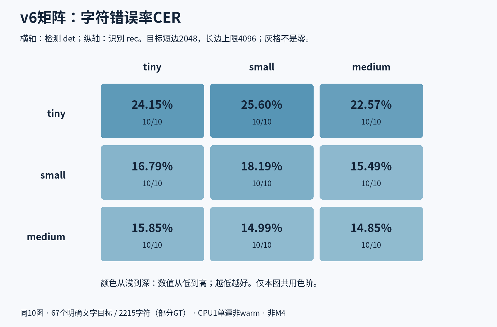
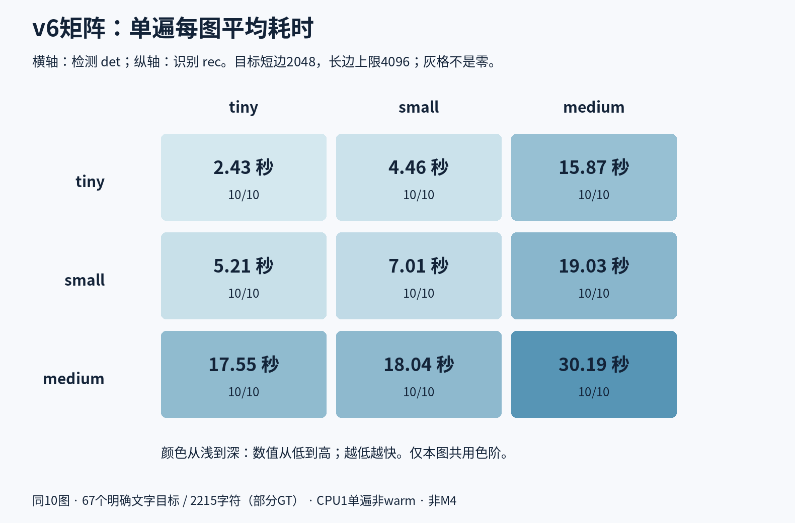
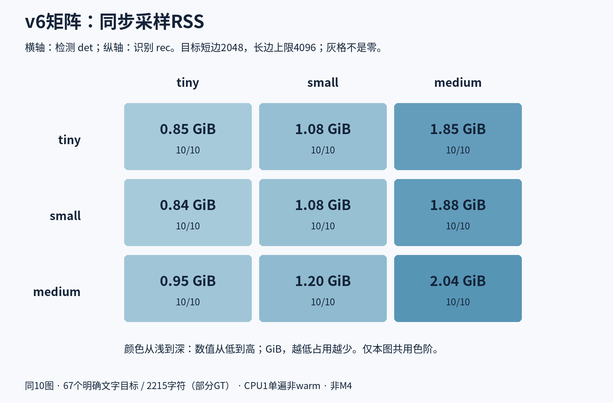
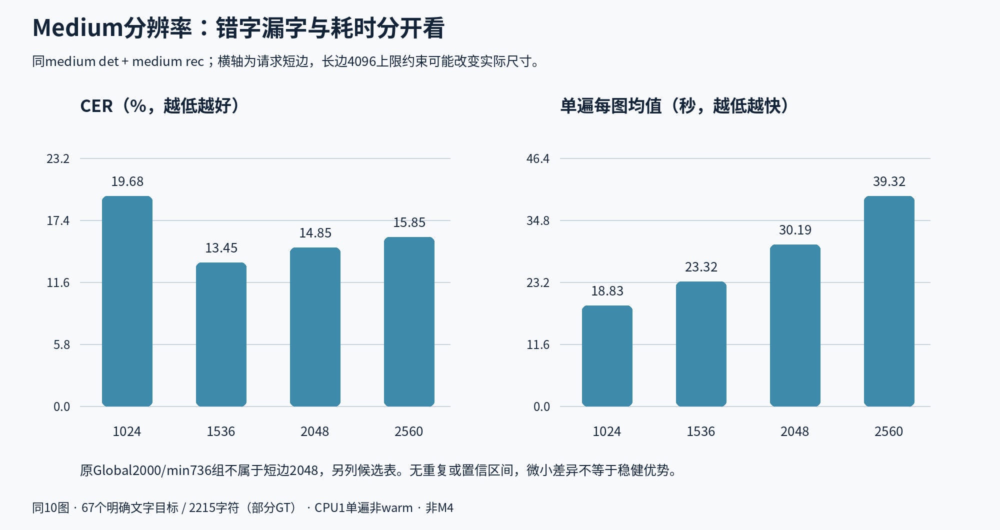
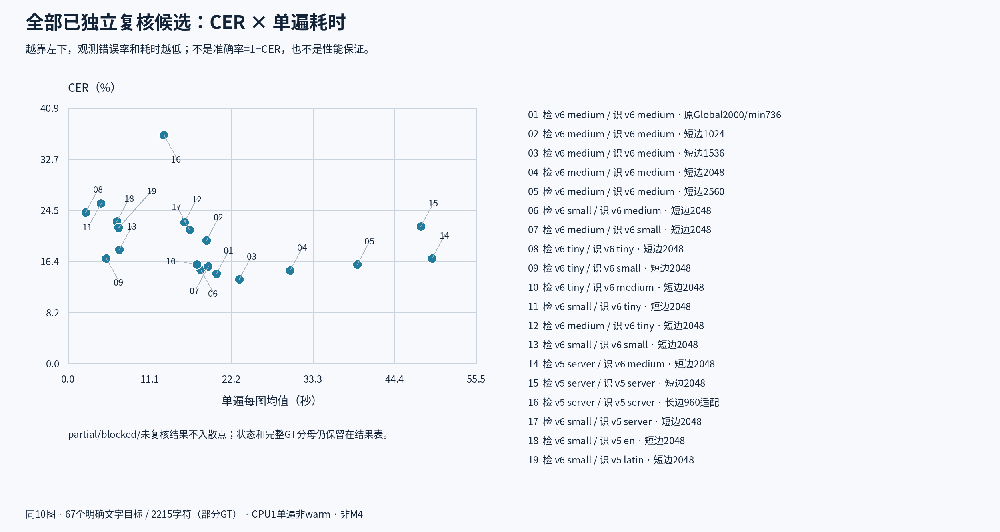

# Paddle模型矩阵：最终实验结果

生成时间：2026-11-03T15:03:19+00:00。预定19组实验均已终态并通过独立评分配对；这不是软件发布声明。

本轮19组全部完成10/10图且通过独立评分配对，共190次图像处理。

## 阅读范围

- v6只有tiny、small、medium；v5 server为另一代，不能称为v6 large。
- 同10张英文漫画，67个明确文字目标、2215个规范化字符；部分页面只标注明确目标，不是整页全文GT，也不是现代漫画总体结论。
- CPU单线程设置，单遍而非warm基准；非Mac M4、非浏览器WASM实测。时间含图像解码/OCR/输出观察，不含初始化和锁等待。
- RSS为约100ms同步采样的协调器+worker之和，可能重计共享页、漏短峰；不是模型文件大小或精确峰值。
- CER保留标点与大小写。小数差异不提供统计显著性证据；失败页必须保留全GT分母。

## v6检测×识别完整矩阵

横轴det，纵轴rec；short2048/cap4096。所有空缺和失败均显式标记，不使用零填充。







## Medium分辨率



## 全部已汇总候选



|图例编号／候选|状态|完成图|CER（全2215字符）|WER|S/D/I|单遍均值秒¹|同步RSS GiB|权重合计MB²|外置字典字节|
|---|---|---:|---:|---:|---:|---:|---:|---:|---:|
|01 · 01_medium_original_params|completed|10/10|14.36%|39.46%|108/170/40|20.170|1.102|139.335|0|
|02 · 02_medium_1024|completed|10/10|19.68%|47.89%|124/271/41|18.826|1.373|139.335|0|
|03 · 03_medium_1536|completed|10/10|13.45%|39.66%|110/139/49|23.322|1.487|139.335|0|
|04 · 04_medium_2048|completed|10/10|14.85%|38.51%|120/155/54|30.189|2.044|139.335|0|
|05 · 05_medium_2560|completed|10/10|15.85%|42.15%|134/161/56|39.324|3.015|139.335|0|
|06 · 06_small_det_medium_rec_2048|completed|10/10|14.99%|38.51%|106/169/57|18.040|1.198|87.145|0|
|07 · 07_medium_det_small_rec_2048|completed|10/10|15.49%|42.72%|122/188/33|19.029|1.881|83.939|0|
|08 · 08_tiny_2048|completed|10/10|24.15%|58.62%|231/238/66|2.429|0.851|6.905|0|
|09 · 09_tiny_det_small_rec_2048|completed|10/10|16.79%|45.59%|106/218/48|5.212|0.837|23.650|0|
|10 · 10_tiny_det_medium_rec_2048|completed|10/10|15.85%|40.80%|112/183/56|17.554|0.951|79.045|0|
|11 · 11_small_det_tiny_rec_2048|completed|10/10|25.60%|56.51%|257/236/74|4.461|1.081|15.005|0|
|12 · 12_medium_det_tiny_rec_2048|completed|10/10|22.57%|57.66%|251/205/44|15.873|1.847|67.195|0|
|13 · bridge_small_2048|completed|10/10|18.19%|43.49%|109/242/52|7.012|1.077|31.750|0|
|14 · server_det_v6medium_rec_common2048|completed|10/10|16.75%|43.30%|139/185/47|49.512|3.656|165.332|0|
|15 · v5_server_common2048|completed|10/10|21.90%|54.21%|157/315/13|48.004|3.682|173.205|74012|
|16 · v5_server_native960|completed|10/10|36.52%|65.71%|98/690/21|13.014|0.917|173.205|74012|
|17 · v6small_det_server_rec_common2048|completed|10/10|21.35%|53.64%|103/342/28|16.580|1.167|95.018|74012|
|18 · small_det_en_rec_common2048|completed|10/10|22.71%|44.83%|148/304/51|6.668|1.092|18.387|0|
|19 · small_det_latin_rec_common2048|completed|10/10|21.72%|44.25%|128/313/40|6.903|1.084|18.557|2616|

native960是长边960适配：采用官方检测缩放参数（内部长边960/ceil128）、原图识别裁剪与共同Rapid/classifier桥接，并非完整官方PaddleX端到端，不属于共同short2048/cap4096组；全部候选图展示不同配置的观测取舍，不能将跨配置差异只归因于模型。

¹ partial的时间如有，只针对成功返回页面，不可与完整10图时间作为同质量结果比较。partial/blocked不进入散点或热力图有效数值。

² 权重合计为本次实际det＋rec＋固定legacy_cls文件字节之和，十进制MB=1,000,000字节；外置字典另列，已嵌入字典不重复计算。不含runtime、其他配置或缓存。数据来自[实际模型组件清单](data/model-components.json)，不能与MODELS.md的官方参考导出大小混用，也不是RSS。

## 来源与复现

图表由[charts.py](charts.py)从运行聚合与独立复核聚合自动生成。[公开白名单数据](assets/chart-data.json)保留输入文件哈希及聚合指标，不含原图、全文GT或全文预测。

运行示例（私有目录路径按实际环境替换）：

```sh
python3 charts.py --run-summary PRIVATE_V6/summary-no-gt.json --run-summary PRIVATE_EXPANDED/server-summary-no-gt.json --run-summary PRIVATE_EXPANDED/language-summary-no-gt.json --review-dir PRIVATE_V6/independent-review --review-dir PRIVATE_EXPANDED/independent-review --complete
```

生成PNG需要Python、Pillow及脚本指定路径的Noto Sans CJK字体；SVG同时保留。--model-components默认读取本目录data/model-components.json。

可重复传入两种参数以加入后续阶段。脚本拒绝SHA不匹配、状态冲突、重复scheme及非2215字符分母；仅completed且10/10且复核完成的候选进入有效点。
